# Thesis-ready research results

Copenhagen includes Frederiksberg. This reporting-only synthesis uses the frozen final rerun; no model was refitted. Within-city Y is log original positive nightly asking price. Transfer Y subtracts each city’s frozen eligible-reference mean. Income and property prices are absent; M0=X, ME=X+E, MW=X+W, MEW=X+E+W.

## 1. Final samples

| city | raw_listings | eligible_conventional_dwellings | positive_price_listings | inside_study_area | prediction_n | association_n | operational_neighbourhoods | association_missing_percent | reference_n | reference_geometric_mean_native_price | currency |
| --- | --- | --- | --- | --- | --- | --- | --- | --- | --- | --- | --- |
| Copenhagen | 23144 | 21080 | 12521 | 12508 | 12408 | 12285 | 11 | 0.9913 | 12508 | 1818.1562 | DKK |
| Oslo | 13391 | 11776 | 8557 | 8557 | 8529 | 8152 | 17 | 4.4202 | 8557 | 2048.0531 | NOK |
| Stockholm | 4806 | 3834 | 2510 | 2510 | 2495 | 2348 | 11 | 5.8918 | 2510 | 2233.2352 | SEK |

[sample flow](../outputs/tables/sample_flow.md)

Inside Airbnb operational groups define primary holdouts; accepted municipal masks define membership, not official validation-area certification. Minimum15 outer-test and500 complementary training observations are retained. The researcher changed association eligibility from5% to10% after observing Stockholm missingness; complete cases remain unchanged and no bedrooms/outcomes are filled.

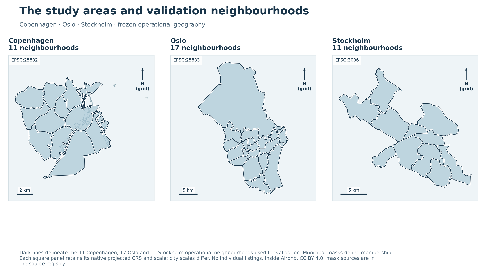

Frozen public operational geography and accepted study masks; no individual listings.

## 2. RQ1 — measurement

| City | Concept | Euclidean median | Walking median | Unit |
| --- | --- | --- | --- | --- |
| Copenhagen | station | 0.4044 | 0.6375 | km |
| Copenhagen | bus | 0.1296 | 0.2186 | km |
| Oslo | station | 0.6683 | 0.8966 | km |
| Oslo | bus | 0.1371 | 0.2187 | km |
| Stockholm | station | 0.3881 | 0.6404 | km |
| Stockholm | bus | 0.1234 | 0.2167 | km |

| City | Concept | Euclidean median | Walking median | Unit |
| --- | --- | --- | --- | --- |
| Copenhagen | food | 84.0000 | 47.0000 | destinations |
| Copenhagen | culture | 6.0000 | 3.0000 | destinations |
| Oslo | food | 63.0000 | 35.0000 | destinations |
| Oslo | culture | 8.0000 | 4.0000 | destinations |
| Stockholm | food | 51.0000 | 28.0000 | destinations |
| Stockholm | culture | 4.0000 | 2.0000 | destinations |

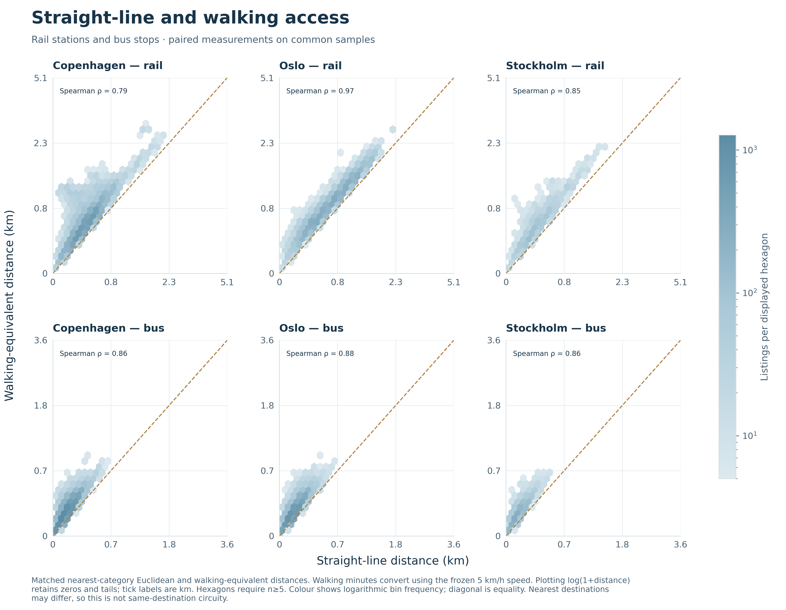

Paired nearest-category distances; matched universes, not same-destination circuity.

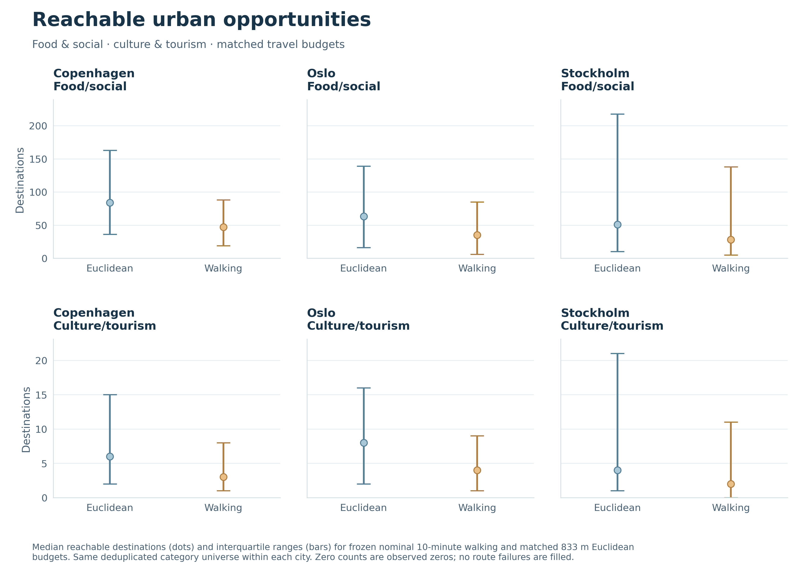

Median and interquartile opportunity counts under the frozen nominal10-minute budgets.

Walking distances and reachability differ from straight-line measurements. Display transformations, suppressed bins and map colour caps do not alter model features. [accessibility descriptive statistics](../outputs/tables/accessibility_descriptive_statistics.md) and [nearest access divergence](../outputs/metrics/nearest_access_divergence.md) retain precise summaries. [Spatial map](../outputs/figures/accessibility_spatial.png) is appendix evidence.

## 3. RQ2 — within-city prediction

| city | estimator | M0 | ME | MW | MEW |
| --- | --- | --- | --- | --- | --- |
| Copenhagen | OLS | 0.335021 | 0.326290 | 0.328703 | 0.327426 |
| Copenhagen | XGBoost | 0.339247 | 0.330229 | 0.329782 | 0.328578 |
| Oslo | OLS | 0.358725 | 0.358882 | 0.359505 | 0.359364 |
| Oslo | XGBoost | 0.349470 | 0.350149 | 0.350349 | 0.351829 |
| Stockholm | OLS | 0.438915 | 0.413797 | 0.414270 | 0.412448 |
| Stockholm | XGBoost | 0.406336 | 0.389245 | 0.386442 | 0.387750 |

| City | Model | ΔRMSE | % RMSE change | Stability low | Stability high |
| --- | --- | --- | --- | --- | --- |
| Copenhagen | ME | -0.009018 | -2.658144 | -0.016745 | -0.001492 |
| Copenhagen | MW | -0.009465 | -2.789890 | -0.022469 | 0.001358 |
| Copenhagen | MEW | -0.010669 | -3.144927 | -0.021869 | -0.000223 |
| Oslo | ME | 0.000679 | 0.194344 | -0.003069 | 0.004772 |
| Oslo | MW | 0.000879 | 0.251548 | -0.002979 | 0.005006 |
| Oslo | MEW | 0.002358 | 0.674853 | -0.000962 | 0.006384 |
| Stockholm | ME | -0.017091 | -4.206129 | -0.028548 | 0.001864 |
| Stockholm | MW | -0.019894 | -4.895905 | -0.032410 | -0.000879 |
| Stockholm | MEW | -0.018586 | -4.573968 | -0.031086 | 0.001189 |

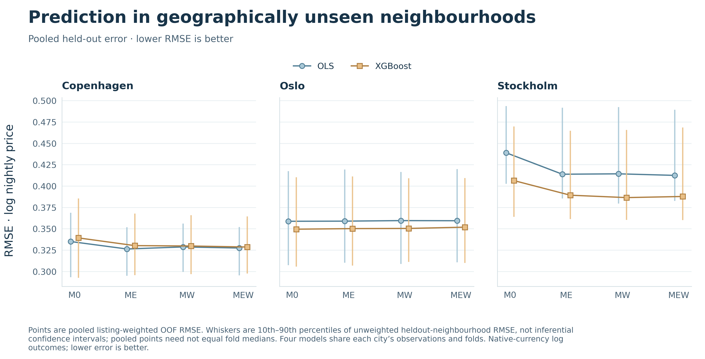

Pooled primary errors and descriptive fold variation.

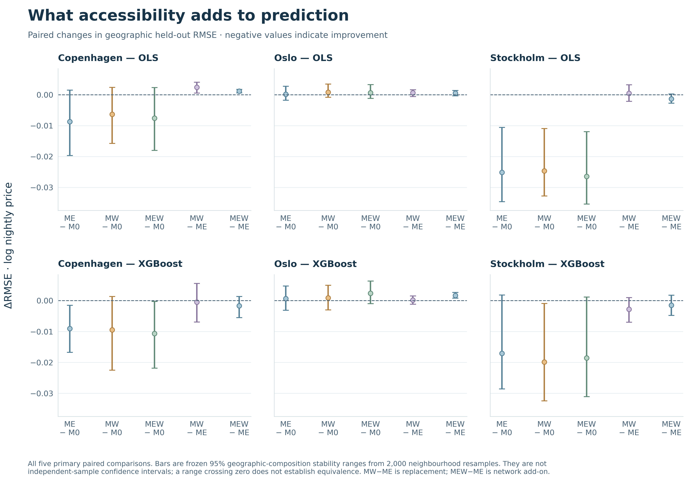

All five paired contrasts, including network replacement and add-on.

Accessibility point gains occur in Copenhagen/Stockholm with adverse Oslo changes. The intervals are neighbourhood-composition stability ranges, not independent-sample confidence intervals. [paired model contrasts](../outputs/tables/paired_model_contrasts.md) provides every estimator/model comparison; heldout contributions are appendix interpretation, not causality.

## 4. RQ2 complementary OLS associations

[association results](../outputs/tables/association_results.md)

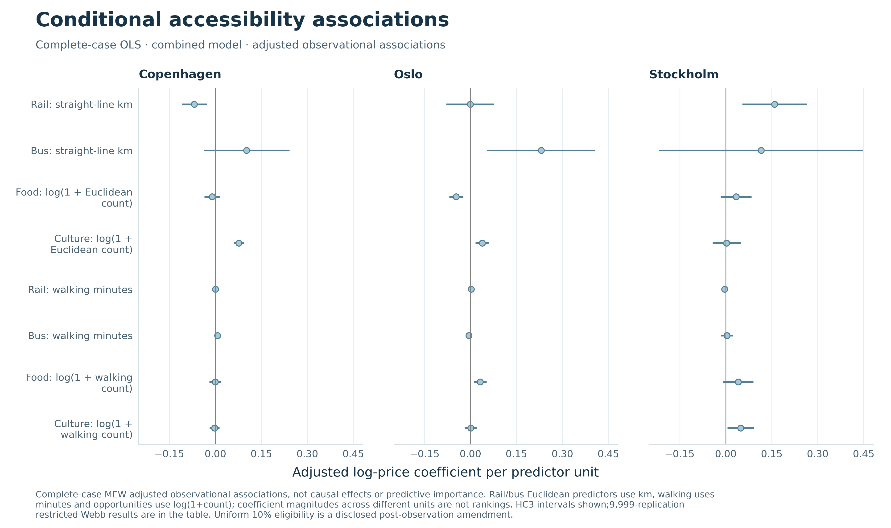

MEW complete-case adjusted associations with95% HC3 intervals; predictor-specific units.

All three cities have four prescribed association models,9,999 restricted Webb draws, rank/condition/VIF diagnostics and residual checks. The transparent post-observation10% eligibility threshold permits complete-case inference but does not correct missingness selection or establish a universal standard. Collinear representations and differing predictor units limit coefficient/SHAP rankings; no causal effects are identified.

## 5. RQ3 — geographic generalization

| City | Estimator | Primary M0 RMSE | Random M0 RMSE | MW improves geometric variants | Geometric variants |
| --- | --- | --- | --- | --- | --- |
| Copenhagen | OLS | 0.335021 | 0.325305 | 6 | 6 |
| Copenhagen | XGBoost | 0.339247 | 0.310875 | 5 | 6 |
| Oslo | OLS | 0.358725 | 0.355792 | 3 | 6 |
| Oslo | XGBoost | 0.349470 | 0.338318 | 0 | 6 |
| Stockholm | OLS | 0.438915 | 0.415671 | 6 | 6 |
| Stockholm | XGBoost | 0.406336 | 0.366871 | 2 | 6 |

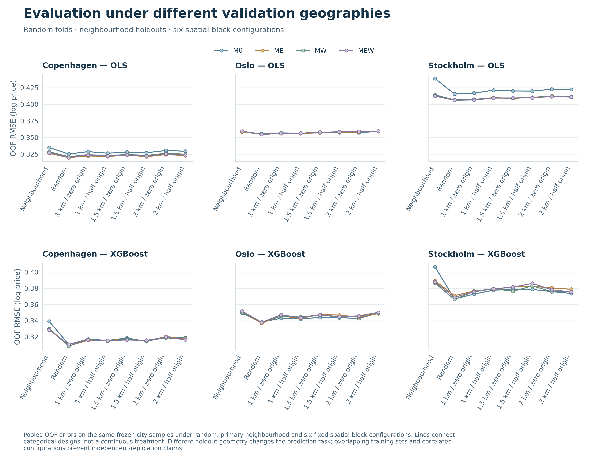

Random, neighbourhood and all six fixed spatial-block configurations.

[validation comparison](../outputs/tables/validation_comparison.md)

## 6. RQ3 — cross-city consistency

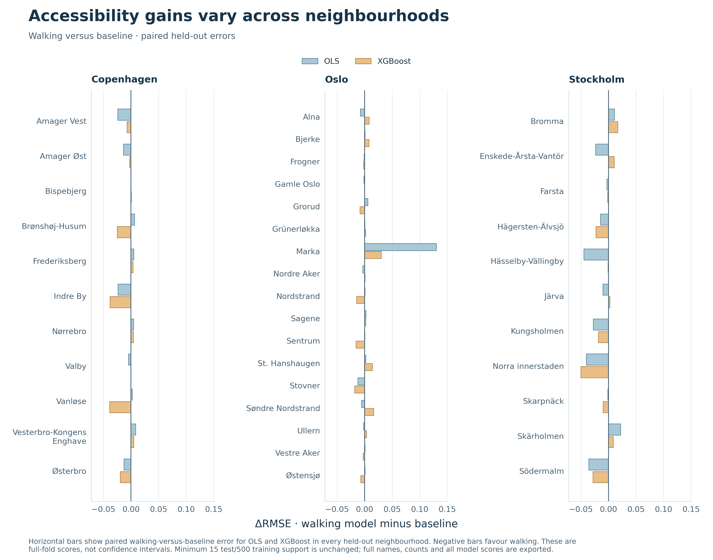

Paired MW−M0 errors for every primary neighbourhood.

The geographic sign counts and local scores qualify citywide averages. Different samples/dispersion, uneven folds, overlapping training sets and residual dependence prevent claims of independent cross-design replication. [neighbourhood performance](../outputs/metrics/neighbourhood_performance.md) preserves all four model/estimator scores and [neighbourhood support](../outputs/metrics/neighbourhood_support.md) records support.

## 7. RQ4 — cross-city transferability

| source_city | target_city | estimator | M0 | ME | MW | MEW |
| --- | --- | --- | --- | --- | --- | --- |
| Copenhagen | Oslo | OLS | 0.377704 | 0.371632 | 0.374375 | 0.371552 |
| Copenhagen | Oslo | XGBoost | 0.364294 | 0.365437 | 0.369727 | 0.366639 |
| Copenhagen | Stockholm | OLS | 0.446377 | 0.432667 | 0.434201 | 0.432603 |
| Copenhagen | Stockholm | XGBoost | 0.428611 | 0.413639 | 0.417356 | 0.413559 |
| Oslo | Copenhagen | OLS | 0.339232 | 0.337430 | 0.338523 | 0.337877 |
| Oslo | Copenhagen | XGBoost | 0.335600 | 0.336783 | 0.337445 | 0.339070 |
| Oslo | Stockholm | OLS | 0.437073 | 0.432868 | 0.435755 | 0.432557 |
| Oslo | Stockholm | XGBoost | 0.425962 | 0.424414 | 0.426995 | 0.425788 |
| Stockholm | Copenhagen | OLS | 0.353722 | 0.342665 | 0.343189 | 0.344650 |
| Stockholm | Copenhagen | XGBoost | 0.351472 | 0.342660 | 0.346121 | 0.345986 |
| Stockholm | Oslo | OLS | 0.392293 | 0.404841 | 0.397645 | 0.405690 |
| Stockholm | Oslo | XGBoost | 0.383695 | 0.380354 | 0.381576 | 0.379199 |

| Estimator | Model | Improving directions | Directions |
| --- | --- | --- | --- |
| OLS | ME | 5 | 6 |
| OLS | MW | 5 | 6 |
| OLS | MEW | 5 | 6 |
| XGBoost | ME | 4 | 6 |
| XGBoost | MW | 3 | 6 |
| XGBoost | MEW | 4 | 6 |

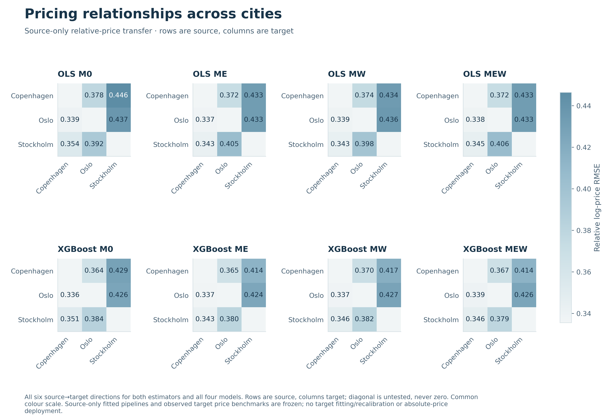

All six relative-price source→target directions and four models.

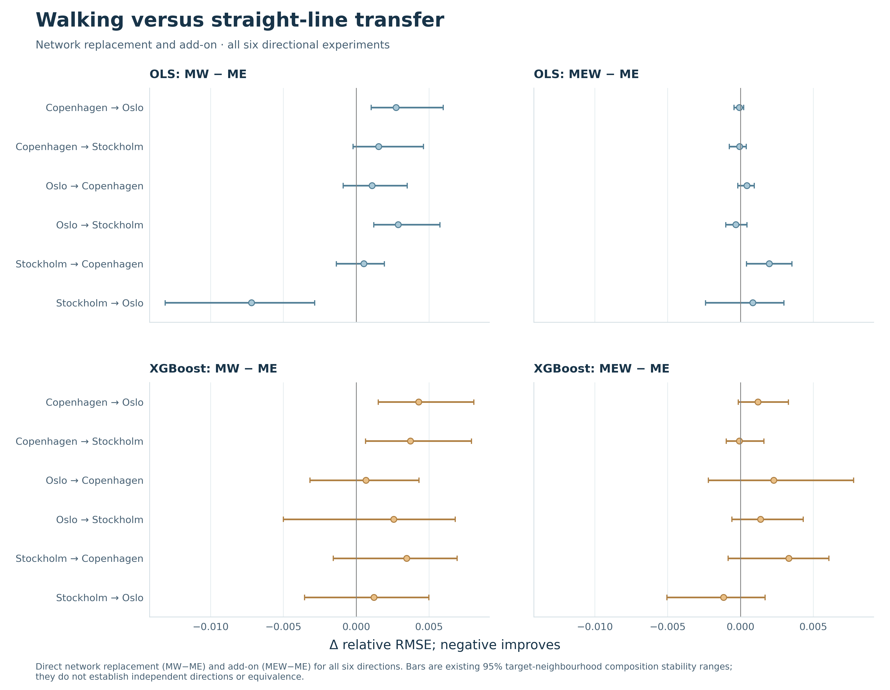

Direct network replacement/add-on with existing target-composition ranges.

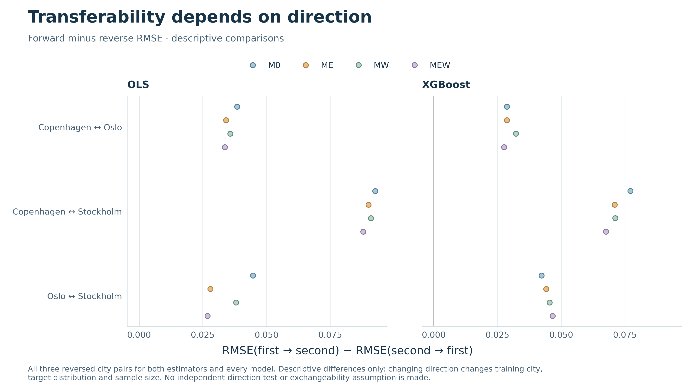

Descriptive reversal differences; source and target tasks change.

The observed target reference is used only for centring/evaluation. Twenty-four shared source pipelines produce48 estimator/model-direction prediction sets; no target fit/tuning/recalibration occurs. [transfer contrasts](../outputs/tables/transfer_contrasts.md) includes all five comparisons. [Binned prediction diagnostics](../outputs/figures/transfer_prediction_diagnostics.png) and [baseline transfer gains](../outputs/figures/transfer_accessibility_gains.png) are appendix evidence, not new fitted models.

## 8. Robustness

[robustness registry](../outputs/tables/robustness_registry.md)

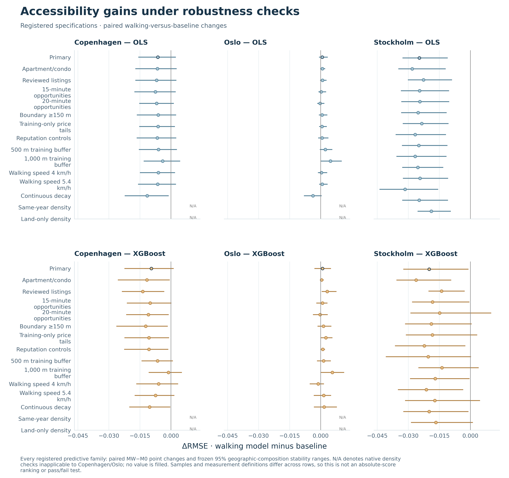

Within-variant paired MW−M0 changes, stability and genuine native-source N/A entries.

The exhaustive registry accounts for every requested variant. Training-tail restriction, imputation and tuning remain source-training-only. All triggered spatial-error and four-model area fixed-effect checks are complete; density is correctly absorbed. Variant samples/definitions can differ, so the plot is not an absolute-score ranking. [Residual spatial diagnostics](../outputs/figures/residual_spatial_diagnostics.png) remain appendix evidence.

## 9. Main limitations

Original asking prices are not transactions/bookings/revenue. Strong missing-price attrition and complete-case selection constrain representativeness. Operational provider boundaries differ from municipal/native context footprints; population/area vintages, rounded Stockholm denominators and incomplete OSM coverage remain limitations. Displaced coordinates, connectors, components and finite extraction can affect accessibility. Few groups and spatial dependence qualify stability. Three capitals do not represent all Nordic cities. The10% eligibility rule was changed after inspecting missingness. Transfer uses observed target means and cannot certify absolute deployment.

## 10. Claims supported

| Candidate claim | Status | RQ | Evidence and qualification |
| --- | --- | --- | --- |
| Accessibility measurements differ on matched categories | SUPPORTED | RQ1 | Nearest relationships and opportunity summaries; compare final samples, not every listing/destination |
| Accessibility lowers primary XGBoost RMSE in Copenhagen and Stockholm | SUPPORTED_WITH_QUALIFICATION | RQ2 | Point gains on frozen neighbourhood validation; composition intervals can include zero |
| Accessibility universally improves primary prediction | NOT_SUPPORTED | RQ2 | Oslo point changes are adverse; estimator/validation dependence remains |
| Walking accessibility is universally superior to Euclidean accessibility | NOT_SUPPORTED | RQ2/RQ4 | Replacement/add-on contrasts vary by city, estimator and direction |
| Euclidean and walking predictions are statistically equivalent | NOT_SUPPORTED | RQ2 | Overlapping stability ranges or small point differences do not establish equivalence |
| Geographic validation is harder than random CV for the observed primary tasks | SUPPORTED_WITH_QUALIFICATION | RQ3 | Frozen task-specific M0 comparisons; not a universal rule for every configuration |
| Primary accessibility gains are geographically uniform | NOT_SUPPORTED | RQ3 | Neighbourhood and block results show heterogeneity and reversals |
| Transferability depends on source/target direction | SUPPORTED_WITH_QUALIFICATION | RQ4 | Observed relative-price errors and reversals; target distributions and N also change |
| All six directions are independent significance-test replications | DO_NOT_CLAIM | RQ4 | Shared source pipelines and overlapping targets invalidate that interpretation |
| Relative-price transfer is zero-shot absolute-price deployment | DO_NOT_CLAIM | RQ4 | Target reference mean uses observed target prices; no absolute deployment test |
| Accessibility causes Airbnb prices or housing displacement | DO_NOT_CLAIM | All | Observational asking prices and adjusted associations do not identify causality |
| Results represent every Nordic or European city | DO_NOT_CLAIM | All | Three selected capital-city samples do not establish that external validity |
| The 10% eligibility limit was preregistered or universal | DO_NOT_CLAIM | RQ2 | Explicitly changed after observing Stockholm missingness; complete-case selection remains a limitation |

[Figure/table recommendations](thesis_figure_recommendations.md), [RQ-by-RQ synthesis](findings_by_research_question.md), [final claims audit](../docs/final_claims_for_thesis.md), [initial gap audit](deliverable_gap_audit.md) and [artifact provenance](thesis_artifact_manifest.json) provide the complete writing/release trail. Markdown is authoritative: no supported active proposal/plan/results DOCX/PDF export pipeline exists. Scientific figures are supplied as 300-dpi PNG files.
